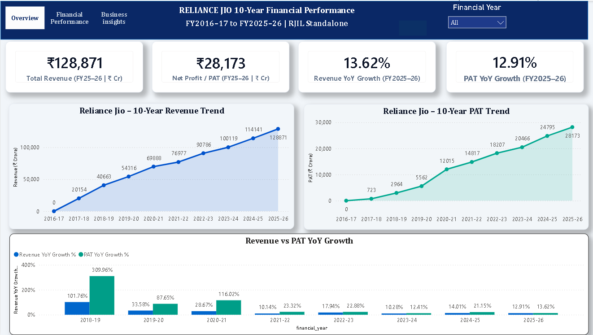
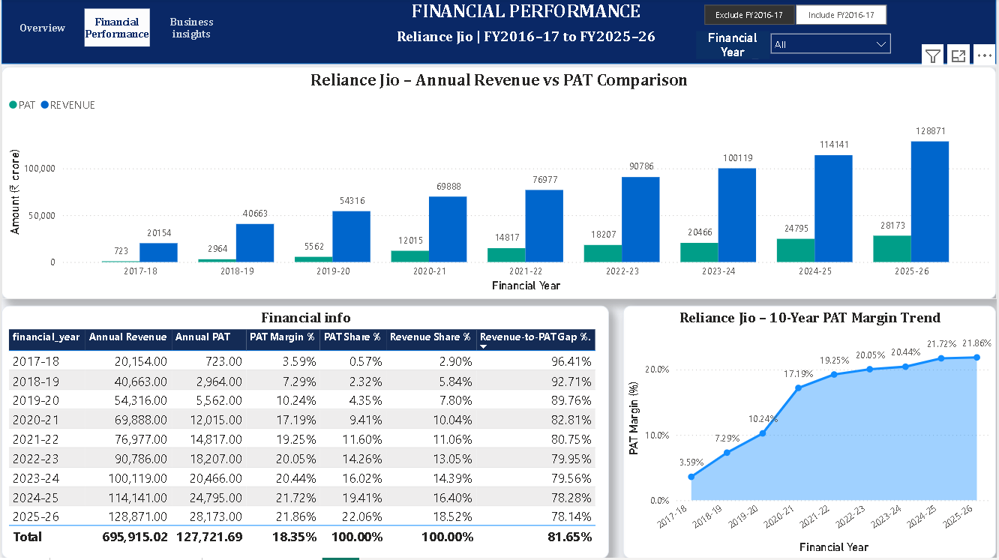
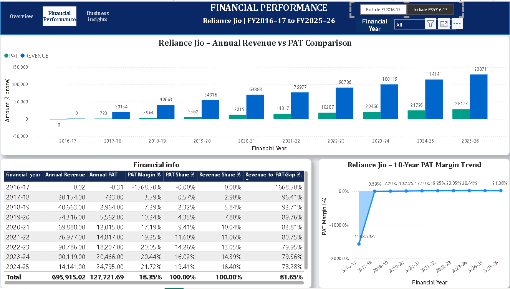
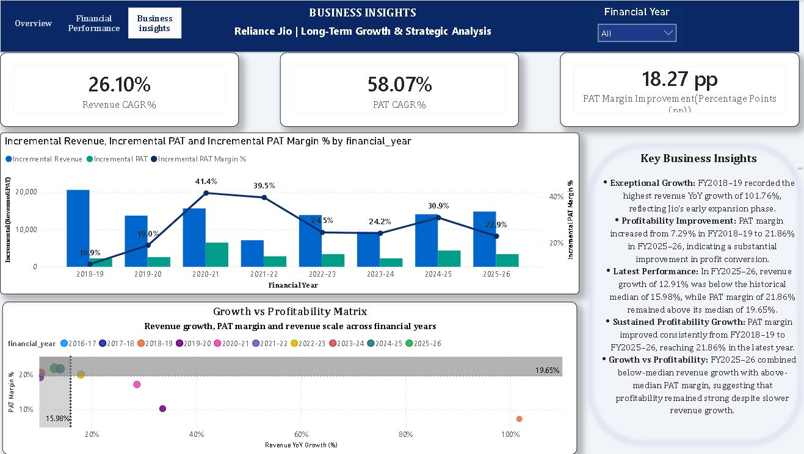

\# Reliance Jio – 10-Year Business Intelligence \& Growth Analysis

An end-to-end Business Intelligence project analyzing Reliance Jio's financial and business performance using PostgreSQL, SQL, Power BI, and DAX.

\## Project Overview

This project explores Reliance Jio's financial performance and business growth through data analysis and interactive dashboards.

\*\*Project period:\*\* FY 2016–17 to FY 2025–26

\## Tools \& Technologies

\- PostgreSQL

\- SQL

\- Power BI Desktop

\- DAX

\- Git \& GitHub

\## Key Analysis Areas

\- Revenue and PAT performance

\- Year-over-year financial growth

\- Profitability and expense ratios

\- Business performance indicators

\- Historical performance trends

\## Repository Structure

\- `sql/` – SQL scripts and database export

\- `power\_bi/` – Power BI dashboard

\- `screenshots/` – Dashboard screenshots

\- `documentations/` – Project documentation

\## Data Sources

Data is compiled from publicly available Reliance Jio financial statements, Reliance Industries annual reports, and other relevant official publications.

\## Important Note

Financial figures are analyzed according to their respective reporting entities and reporting bases. RJIL standalone figures should not be interpreted as Reliance Industries consolidated or segment figures.
## Dashboard Preview

### Executive Overview

### Financial Information (Excluding FY2016-17)

### Financial Information (Including FY2016-17)

### Business Insights

\## Author

\*\*Husain Amjherawala\*\*

GitHub: \[Husain75-python](https://github.com/Husain75-python)

